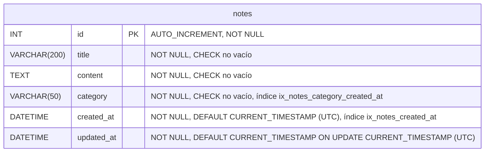

# Modelo de datos — `notes_db`

Esquema de la primera versión de la API, creado por la migración de Alembic
`0001` (`alembic/versions/2026_10_10_0001_create_notes_table.py`) y definido en
`app/models/note.py`.

- Diagrama Mermaid (fuente): [`database_diagram.mmd`](database_diagram.mmd)
- Diagrama renderizado: [`database_diagram.svg`](database_diagram.svg)



La primera versión tiene **una sola tabla** (`notes`). No existen claves foráneas
ni relaciones con otras tablas. Alembic añade además su tabla interna
`alembic_version`, que no forma parte del modelo de dominio y por eso no aparece
en el diagrama.

## Tabla `notes`

| Columna      | Tipo MySQL     | Nulo | Valor por defecto                                   | Descripción                          |
|--------------|----------------|------|-----------------------------------------------------|--------------------------------------|
| `id`         | `INT`          | No   | `AUTO_INCREMENT`                                    | Clave primaria                       |
| `title`      | `VARCHAR(200)` | No   | —                                                   | Título de la nota                    |
| `content`    | `TEXT`         | No   | —                                                   | Contenido (hasta 64 KB)              |
| `category`   | `VARCHAR(50)`  | No   | —                                                   | Categoría libre (p. ej. "Estudio")   |
| `created_at` | `DATETIME`     | No   | `CURRENT_TIMESTAMP`                                 | Fecha de creación en UTC             |
| `updated_at` | `DATETIME`     | No   | `CURRENT_TIMESTAMP ON UPDATE CURRENT_TIMESTAMP`     | Última modificación en UTC           |

Motor `InnoDB`, juego de caracteres `utf8mb4` y colación `utf8mb4_unicode_ci`.

### Restricciones

| Nombre                         | Tipo        | Regla                                  |
|--------------------------------|-------------|----------------------------------------|
| `PRIMARY`                      | PRIMARY KEY | `id`                                   |
| `ck_notes_title_not_blank`     | CHECK       | `CHAR_LENGTH(TRIM(title)) > 0`         |
| `ck_notes_content_not_blank`   | CHECK       | `CHAR_LENGTH(TRIM(content)) > 0`       |
| `ck_notes_category_not_blank`  | CHECK       | `CHAR_LENGTH(TRIM(category)) > 0`      |

MySQL aplica las restricciones `CHECK` desde la versión 8.0.16.

### Índices

| Nombre                          | Columnas                 | Consulta a la que da servicio |
|---------------------------------|--------------------------|-------------------------------|
| `ix_notes_created_at`           | `created_at`             | Orden del listado (`ORDER BY created_at DESC, id DESC`; InnoDB añade la clave primaria a los índices secundarios) y serie diaria de actividad filtrada por fechas. |
| `ix_notes_category_created_at`  | `category`, `created_at` | Índice de cobertura para `GROUP BY category` con filtro de fechas: el recuento se resuelve sin leer las filas completas. |

## Decisiones de diseño

- **`INT` autoincremental** como clave primaria: compacta y suficiente para
  notas personales (más de 2.000 millones de registros).
- **`VARCHAR(200)` para `title` y `VARCHAR(50)` para `category`**: longitudes
  acotadas que permiten indexar `category`. Las mismas constantes
  (`TITLE_MAX_LENGTH`, `CATEGORY_MAX_LENGTH`) servirán para validar con Pydantic
  los futuros endpoints de escritura.
- **`TEXT` para `content`**: el contenido no tiene un límite natural corto y no
  se filtra ni se ordena por él.
- **`category` como texto en lugar de una tabla `categories`**: el alcance actual
  no incluye la gestión de categorías. Si en el futuro se necesitan categorías
  con atributos propios (color, descripción, etc.), se podrá normalizar con una
  migración que añada la tabla y una clave foránea.
- **`DATETIME` en lugar de `TIMESTAMP`**: `DATETIME` no tiene el límite del año
  2038 ni realiza conversiones implícitas de zona horaria. La aplicación fija
  `time_zone = '+00:00'` en cada conexión, por lo que `CURRENT_TIMESTAMP` genera
  siempre la hora UTC.
- **`updated_at` gestionado por MySQL** (`ON UPDATE CURRENT_TIMESTAMP`): se
  actualiza también si la fila se modifica fuera de la API, por ejemplo desde
  MySQL Workbench.
- **Restricciones `CHECK`**: impiden guardar títulos, contenidos o categorías
  vacíos o formados solo por espacios, aunque se inserten directamente en la base.
- **Colación `utf8mb4_unicode_ci`**: admite cualquier carácter Unicode (tildes,
  emojis) y compara sin distinguir mayúsculas, así que `Estudio` y `estudio` se
  agrupan como la misma categoría en las estadísticas.

## Zona horaria al insertar desde MySQL Workbench

La API trabaja en UTC. MySQL Workbench usa por defecto la zona horaria del
servidor; si insertas notas manualmente sin indicar `created_at`, ejecuta antes
en esa sesión:

```sql
SET time_zone = '+00:00';
```

## Mantener el diagrama sincronizado

Cada cambio en `app/models/` debe ir acompañado de:

1. Una nueva migración (`alembic revision --autogenerate -m "..."`), revisada a mano.
2. La actualización de `database_diagram.mmd`, de este documento y del bloque
   Mermaid de arriba.
3. La regeneración del SVG (ver la sección "Diagrama de la base de datos" del README).

`alembic check` sirve para confirmar que los modelos y las migraciones coinciden.
